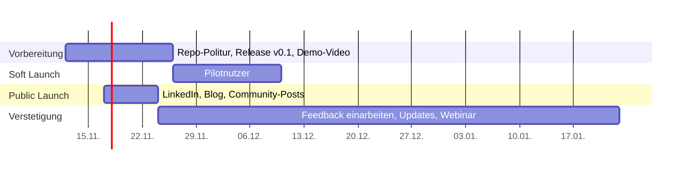

# Kommunikationsstrategie: Artifact Generator for d.velop Process Studio

Stand: 12.11.2026 · Status: Entwurf

## 1. Ausgangslage

- **Projekt:** KI-gestützte Erstellung von BPMN-Prozessen, Formularen (JSON), DMN-Entscheidungstabellen und Skripten für d.velop Process Studio mit GitHub Copilot, spezialisierten Agenten und Vorlagen.
- **Herkunft:** Weiterentwicklung des Ansatzes von GovModeler (Fokus Verwaltungsprozesse).
- **Repo-Stand:** 1 Contributor, 0 Stars, 0 Forks, keine Releases, MIT-Lizenz, deutschsprachig.
- **Einordnung:** Eigenständiges Community-Projekt, kein offizielles d.velop-Produkt. Ergebnisse sind prüfpflichtige Entwürfe, keine validierten Produktivartefakte.

## 2. Kern des Angebots

| Aspekt | Aussage |
|---|---|
| Nutzen | Aus Fachanforderungen werden schneller importierbare Entwürfe, wiederholbar und nachvollziehbar. |
| Differenzierung | Spezialisierung auf d.velop Process Studio mit echten Exportvorlagen (BPMN, DMN, Skript, `camunda:formKey`-Verknüpfung). |
| Offenheit | Open Source (MIT), Beiträge und Testergebnisse ausdrücklich erwünscht. |
| Grenzen | Kein Generator mit garantierter Validierung. DMN- und Skript-Annahmen teilweise ungetestet. |

## 3. Zielgruppenanalyse

| Segment | Wer | Bedarf / Schmerz | Interesse | Priorität |
|---|---|---|---|---|
| **A: Process-Studio-Anwender:innen** | Prozessmanager:innen, Fachadministrator:innen, Workflow-Entwickler:innen bei d.velop-Kunden (v. a. Verwaltung, Mittelstand) | Modellierung, Formulare und Skripte sind zeitaufwendig. Fachbereich und Technik verstehen sich nicht. | Sehr hoch | 1 |
| **B: d.velop-Partner und Beratungshäuser** | Implementierungspartner, Berater:innen | Projekte schneller liefern, Vorlagen wiederverwenden | Hoch (Multiplikatoren) | 1 |
| **C: Verwaltungsdigitalisierung** | Organisationsentwickler:innen, E-Government-Teams, GovModeler-Community | Verwaltungsprozesse standardisiert beschreiben und umsetzen | Hoch (Herkunft des Projekts) | 2 |
| **D: KI- und Copilot-Praktiker:innen** | Entwickler:innen mit Interesse an Agenten und Prompt-Workflows | Referenzbeispiel für domänenspezifische Agenten mit Vorlagen | Mittel | 2 |
| **E: BPMN/DMN-Community** | BPMN-Modellierer:innen | Vorlagen, Beispielprozesse | Mittel bis niedrig | 3 |
| **F: Entscheider:innen** | IT-Leitung, Prozessverantwortliche | Effizienz, Risiko, Datenschutz bei KI | Indirekt (über A und B) | 3 |

### Erkenntnisse

- **Einstiegshürden:** VS Code, GitHub-Copilot-Berechtigung, Zugang zu einer Process-Studio-Testumgebung, BPMN-Grundkenntnisse.
- **Vertrauen:** Datenschutz- und KI-Vorbehalte, besonders in der Verwaltung. Die ehrliche Darstellung der Grenzen im README ist ein Pluspunkt.
- **Reichweite:** Kleine Nische, gut erreichbar. Gezielte Ansprache ist wirksamer als breite Streuung.

## 4. Kanäle

| Kanal | Segment | Format |
|---|---|---|
| d.velop-Community, Partnernetzwerk, Anwendertreffen (Nutzbarkeit vorab klären) | A, B | Vorstellung, Demo, Austausch |
| LinkedIn (#dvelop #BPMN #Prozessautomatisierung #GitHubCopilot #eGovernment) | A, B, C, F | Launch-Post, Kurzvideo, Erfahrungsbericht |
| XING / Fachgruppen zur Verwaltungsdigitalisierung | C | Fachbeitrag |
| GovModeler-Netzwerk | C | Direkte Ansprache |
| Open-Source-Plattformen der Verwaltung (z. B. openCode) | C | Projekt listen, falls passend |
| Blog / Fachartikel (eigener Blog, dev.to, Medium) | A, D | "Von der Prozessbeschreibung zur BPMN-Datei mit Copilot" |
| YouTube / Loom | A, B, D | 3–5 Min Demo: Anforderung → BPMN → Formular → Import |
| GitHub (Topics, About, Releases, Discussions) | alle | Auffindbarkeit |
| Meetups / Webinare (BPMN, Low-Code, KI in der Verwaltung) | A, C, D | Lightning Talk |

## 5. Ziele (erste 3 Monate, Richtwerte)

1. Mindestens 5 Anwender:innen aus Segment A oder B testen das Repo und geben Feedback.
2. Mindestens 3 Rückmeldungen zu Importtests in der Zielumgebung (schließt Lücken bei DMN und Skripten).
3. 25–50 Stars, 2–3 Issues oder Discussions, 1 externer Beitrag.
4. Mindestens 2 Multiplikatoren (Partner, Community) verbreiten das Projekt.

## 6. Kernbotschaften

1. **Hauptbotschaft:** Von der Fachbeschreibung zur importierbaren Process-Studio-Datei, mit KI-Agenten und geprüften Vorlagen.
2. **Vertrauen:** Entwürfe statt Blackbox. Jeder Schritt wird bestätigt, geprüft und im Zielsystem getestet.
3. **Offenheit:** Open Source (MIT). Hilf mit, DMN und Skript-Import zu verifizieren.
4. **Abgrenzung:** Eigenständiges Community-Projekt, kein offizielles d.velop-Produkt.

Zielgruppenspezifisch:

- **A und B:** Zeitersparnis, Vorlagen, Beispielaufträge.
- **C:** Weiterentwicklung von GovModeler, standardisierte Verwaltungsprozesse, synthetische Daten, Datenschutzhinweise.
- **D:** Beispiel für Agent plus Template plus Referenzexport.

## 7. Phasenplan

### Phase 1: Vorbereitung

- [x] README-Inkonsistenzen beheben (`BeispielForms` → `example-forms`, `CreateDMN` im README als „wird bei der ersten Erstellung angelegt“ gekennzeichnet, nicht vorhandenes `DMN.Erfassung.md` und Verweis auf Agentendokumentation entfernt, Ordnertabelle ergänzt).
- [x] Quick Start mit 5 Schritten an den Anfang des README setzen.
- [ ] Screenshots oder GIF im Quick Start ergänzen.
- [ ] GitHub-Topics setzen (`dvelop`, `bpmn`, `dmn`, `github-copilot`, `process-automation`, `egovernment`), englische Kurzbeschreibung im About-Feld, Social-Preview-Bild.
- [ ] `CONTRIBUTING.md`, Issue-Templates (inkl. "Kompatibilitätsmeldung" mit Zielversion und Prüfumfang), GitHub Discussions aktivieren.
- [ ] Release v0.1.0 mit Release Notes und bekannten Grenzen.
- [ ] Demo-Video (3–5 Min) mit durchgängigem Beispiel (z. B. "Telearbeit vereinbaren").
- [ ] Rechtliches: Nutzung der Marke "d.velop" prüfen, ggf. Rücksprache mit d.velop. Disclaimer sichtbar halten. Beispieldateien auf synthetische oder freigegebene Daten prüfen.

### Phase 2: Soft Launch

- [ ] 10–15 Personen direkt ansprechen (Kolleg:innen, GovModeler-Kontakte, Partner).
- [ ] Bitte: einen Workflow testen und Importergebnisse melden.
- [ ] Feedback einarbeiten, Release v0.2.

### Phase 3: Public Launch

- **Tag 1:** LinkedIn-Post mit Video und Repo-Link.
- **Tag 2–3:** Fachartikel oder Blogbeitrag, Posts in der d.velop-Community und in Fachgruppen.
- **Tag 4–7:** Zweiter Post mit Ergebnisbeispiel (Vorher/Nachher), Nachfassen bei Multiplikatoren.

### Phase 4: Verstetigung

- [ ] Alle 2–4 Wochen ein kurzer Update-Post (Release, Testergebnisse, Contributor-Dank).
- [ ] Webinar oder Lightning Talk (30 Min Live-Demo).
- [ ] "Good first issues" ausschreiben (neue Vorlagen, Beispielprozesse).
- [ ] Kennzahlenreview nach 3 Monaten.

## 8. Beispiel-Launch-Post (LinkedIn)

> Aus der Prozessbeschreibung zur importierbaren d.velop-Process-Studio-Datei: Ich veröffentliche den **Artifact Generator for d.velop Process Studio**.
>
> Mit GitHub Copilot, spezialisierten Agenten und Vorlagen entstehen BPMN-Prozesse, Formulare, DMN-Tabellen und Skripte als prüfbare Entwürfe. Das Projekt führt den Ansatz von GovModeler weiter.
>
> Open Source (MIT), eigenständiges Community-Projekt, kein offizielles d.velop-Produkt.
>
> Ich suche Tester:innen, die Importe in ihrer Umgebung ausprobieren, besonders für DMN und Skripte.
>
> Repo: [Link]
>
> #dvelop #BPMN #GitHubCopilot #Prozessautomatisierung #eGovernment

## 9. Risiken und Gegenmaßnahmen

| Risiko | Gegenmaßnahme |
|---|---|
| Erwartung eines fertigen Generators | Botschaft "Entwurf, Prüfung, Test" in jedem Beitrag |
| Datenschutzbedenken bei KI | Hinweis auf synthetische Daten, keine Echtdaten im Repo, Verweis auf Organisationsvorgaben |
| Markenrechtliche Unklarheit mit d.velop | Disclaimer, Abstimmung mit d.velop |
| Wenig Resonanz bei Nischenthema | Fokus auf direkte Ansprache und Multiplikatoren statt Reichweite |
| Hohe Einstiegshürde (Copilot-Lizenz) | Quick Start, Demo-Video, Beispielergebnisse direkt im Repo einsehbar |

## 10. Erfolgsmessung

- **Quantitativ:** Stars, Forks, Clones und Views (GitHub Insights), Issues und Discussions, Video-Aufrufe, LinkedIn-Interaktionen.
- **Qualitativ:** Anzahl der Importtests mit Ergebnis, externe Beiträge, Erwähnungen durch Partner, Anfragen zu Workshops.

## 11. Nächste Schritte

1. Klären, ob als Privatperson oder im Namen der Organisation veröffentlicht wird (Freigaben, Absender).
2. d.velop oder den Partnerkontakt über die Veröffentlichung informieren.
3. Phase 1 abarbeiten (README, Release, Demo, Community-Dateien).
4. Pilotliste mit 10–15 Namen erstellen.
